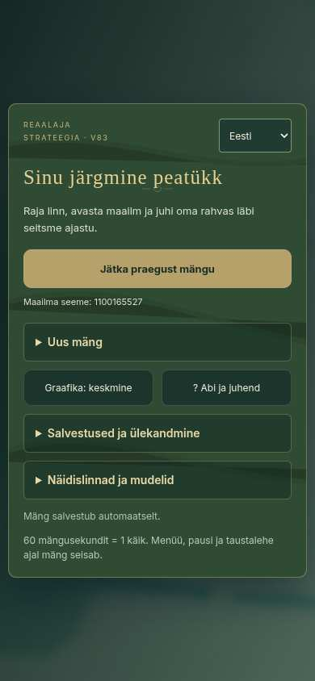

# V83 testimise seis

## Kontrollitud

- Menüü laadimispiir: käivitus õnnestub / import või WebGL käivitus ebaõnnestub; selge veateade, taastamisnupp ning mängutegevuste blokeerimine.
- HTML-i juhtelementide unikaalsus ja olemasolevate mängunuppude säilimine.
- V73 salvestusregressioon: V4 vorming, varukoopiast taastamine, vigased impordid ja väike salvestusmaht.
- V82 hooneregressioon: 65 mudelit; hooneinfo kõigis seitsmes ajastus.
- Ühe seemnega (20261020) 60 mänguminuti majandussimulatsioon, aruanded iga viie mänguminuti järel. Käskude andmiseks kasutati ka mängijapoolel olemasolevat AI otsustusloogikat. Ressursse ei lisatud, ehitisi ei lõpetatud käsitsi ega ajastuid avatud otse. See ei ole käsitsi läbimäng ega lahingute/pildi kontroll. Samm oli 0,5 sekundit (tavaline brauser jagab aja kuni 0,1 sekundi sammudeks).

## Majandussimulatsiooni tulemused

| Mänguminut | Mängijapoole rahvaarv | Oma ehitisi (ka pooleliolevad) | Seis |
|---|---:|---:|---|
| 5 | 4 | 4 | Algmajandus töötab, esimene uurimus veel kestab |
| 10 | 6 | 5 | Toitu 4,4 ühikut, kriitiline toiduhoiatus |
| 20 | 7 | 10 | Toit taastunud 21 ühikuni, kuus avastust |
| 30 | 10 | 15 | Endiselt kiviaeg, ühe vastase toit otsas |
| 40 | 6 | 16 | Oma toit otsas, rahvastik langenud |
| 60 | 10 | 17 | Oma ja ühe vastase pronksiaeg endiselt materjalide taga; kaks vastast pronksiajas |

### Viimistlemist vajavad kinnitatud olukorrad

1. Täis laoga tootmine hoiab endiselt tööjõudu: oma kivimurd oli 120 kivi juures täis ning hoidis kolme töölist, kui toidutootmine vajas abi.
2. Toidunappus kordub; automaatne jaotus jätab palju lisatootmisi väga väikese tööjõuga tööle. Katse ei tõesta optimaalset mängijastrateegiat, kuid näitab AI ja jaotuse taastumisprobleemi.
3. Ühe vastase kivimurd ei pääsenud toorainele ligi; uus kivimurd jäi ehitusjärjekorda. Pronksiaeg ootas 15 kivi ka 60. minutil.
4. Uuritud pronksiaeg jäi mängijapoolel seitsme toiduühiku taha. Materjalide kogumist ja ajastuvahetuse põhjust peab UI arusaadavamalt näitama.

## Brauseris kontrollitud

- GitHubi Chromiumi test läbis arvutivaate (1366×900), telefoni püstvaate (390×844) ja rõhtvaate (844×390).
- Kõigis vaadetes oli jätkamisnupp ilma kerimata nähtav ja leht ei ulatunud horisontaalselt ekraanilt välja.
- Eesti/inglise keele vahetamine, uue maailma loomine, menüü ajal paus, JSON-eksport ja taaslaadimine töötasid.
- Puuduv mängumoodul kuvab käivitusvea ning jätab mängutegevused blokeerituks.
- Telefonivaates päris juhtnuppudega: automaatne avastaja, asuniku kõndimine, linna rajamine, jahipidamise uurimise valik ja metsamaja ehituse alustamine õnnestusid.
- Esimene ehituse valmimise kontroll peatus testi 30-sekundilise vaikimisi ajapiirangu tõttu. Parandatud test kasutas õiget 150-sekundilist ooteaega ja läbis kontrolli: metsamaja valmis umbes 59. mängusekundil ning tööline alustas metsa minekut.

### Pildilt leitud viimistlusvajadused

- Linna nimesildi tekst lõikub telefonivaates sildi servadega.
- Ressursside ülariba on liiga tihe; ressursid ja käiguinfo konkureerivad ruumi pärast.
- Päris Samsung S24 jõudlust pole mõõdetud. Test kasutab tarkvaralist WebGL-i; selle dünaamiliselt vähendatud renderdusresolutsioon ei ole telefoni GPU jõudlusmõõtmine.

## Testmängu ulatus

- Lühike algus läbis ka valmis metsamaja ja maailmakaardilt linna tagasipöördumise kontrolli. Kontroll kestis umbes 63 mängusekundit ning ei asenda täispikka läbimängu.
- Täispikk käsitsi läbimäng ja lahingud.
- Päris Androidi jõudlus.

Parandus on GitHubi harus `feature/v83-menu-polish-playtest`, PR #14. Avaliku mängu peaharu pole selle raporti kirjutamise hetkel muudetud.
